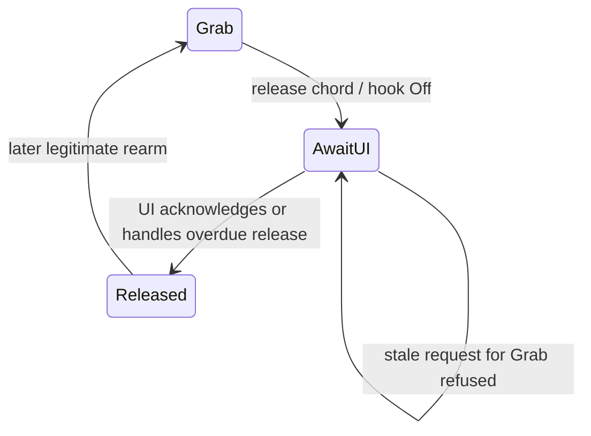
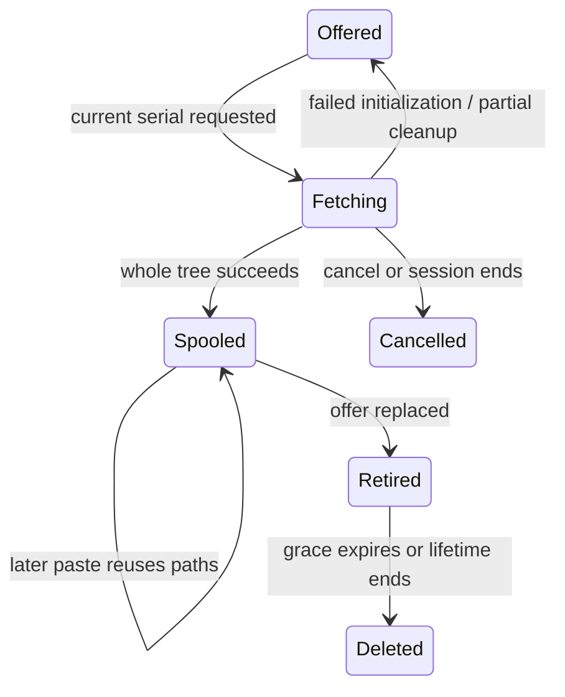
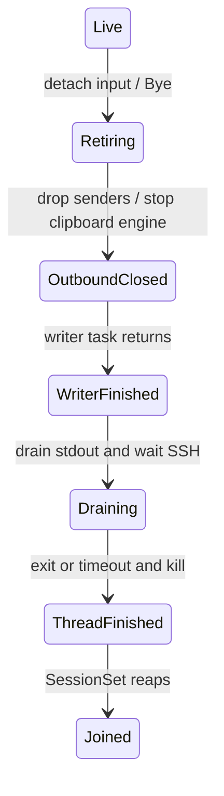

# State machines

This reference describes behavior whose next action depends on earlier events. Some
state is explicit in an enum. Other state is distributed across flags, optional values,
counters, resources, queues, and thread ownership.

The source review used `main` at `312473c6d8761351a74f27af1fd5c621d3a58a96` on
2026-11-06. The review inspected source and existing test coverage. It did not run
builds, tests, formal models, or native gates. The inventory is not a completeness or
correctness proof. Relative links point to the implementation in this checkout.

- **Explicit** means a stored enum names the lifecycle states.
- **Implicit** means fields, resource ownership, or control flow encode them.
- **Hybrid** means an enum names only part of a larger state product.

Entries group related nested machines rather than assign one machine to every flag. An
invariant states the contract the code implements, not a newly proved property.
Transition notation is `A --event [guard] / action--> B`. Native Windows, codec, driver,
compositor, and scheduling effects need runtime validation beyond the pure rules and
effect ordering described below.

## Navigation

- [Connections, sessions, and ownership](#connections-sessions-and-ownership)
- [Keyboard capture and Windows recovery](#keyboard-capture-and-windows-recovery)
- [Pointer and cursor](#pointer-and-cursor)
- [Clipboard ownership, promises, and
  transfers](#clipboard-ownership-promises-and-transfers)
- [Decode, frame delivery, and presentation](#decode-frame-delivery-and-presentation)
- [Window, UI, and geometry](#window-ui-and-geometry)
- [Persistence and process-wide lifetimes](#persistence-and-process-wide-lifetimes)
- [Verification tools and scripts also have
  state](#verification-tools-and-scripts-also-have-state)
- [Explicit state versus event and result
  enums](#explicit-state-versus-event-and-result-enums)
- [Cross-machine coupling](#cross-machine-coupling)
- [Scope and verification limits](#scope-and-verification-limits)

See [architecture](architecture.md) for module ownership and data flow,
[clipboard](clipboard.md) for formats and file rules, and [Windows
quirks](windows-quirks.md) for native constraints and recorded gates.

## Connections, sessions, and ownership

### Protocol handshake

Explicit. `Core.phase: Phase` already names `AwaitHelloAck`, `AwaitStreamConfig`,
`Streaming`, and `Ended`. `initial: ResizeReq`, `pending_keymap: Option<String>`,
`headless: bool`, and `last_resize: Option<ResizeReq>` supplement the phase.

`AwaitHelloAck --compatible HelloAck / Connected, initial Resize, pending keymap-->
AwaitStreamConfig --valid StreamConfig--> Streaming`. Version mismatch, server error, or
unexpected preconfiguration ordering ends the session. `Ended` absorbs later commands.
Ping is answered in every non-ended phase. Before HelloAck, resize replaces the initial
request and keymap is buffered. Clipboard messages are accepted after HelloAck, before
video configuration. Input cleanup still runs before the handshake, without forwarding
ordinary keys.

Invariant: no streaming frame processing before a valid configuration. Tests cover
version mismatch, out-of-order configuration, Ping, and initial resize ordering. [Fields
and dispatch][core-decoded]; [handshake tests][core-tests].

### Session thread, SSH pipes, and shutdown

Implicit. `SessionHandle.thread: Option<JoinHandle<SessionEnd>>`; driver `Session.tx:
Option<UnboundedSender<_>>`, `engine: Option<EngineThread>`, `reason:
Option<EndReason>`, decoder, clocks, and the locally owned SSH child/reader/writer tasks
encode several lifetimes.

`Unstarted -> decoder ready -> SSH spawned -> reader/writer running -> command loop ->
session sender dropped -> clipboard engine stopped -> writer finished -> inbound EOF drained
and SSH reaped -> joined`. Spawn failure and link loss choose different reporting paths.
Join consumes the handle and reports panic or an already-joined handle. Whole-message
reads live in a dedicated task because partial reads are not cancellation-safe.

Invariant: all sender owners must disappear before stdin can close; EOF must be drained
so the remote writer cannot block shutdown. The five-second timeout covers the
finishing/drain/child-wait section, **not the preceding writer await**. An Ended
notification is not the same as a reaped process. Driver tests cover command coalescing,
clocks, and clean-exit classification; full OS teardown is not established by those
tests. [Handle and launch][driver-finish]; [loop and finish][driver-finish]; [link-loss
handling][driver-finish].

### Tab lifecycle and session identity

Hybrid. `Tab.status: Status` is explicit, but `session: Option<SessionId>`, `Backoff`,
`known`, `open`, `record_pending`, and `failure` carry additional state. `Tabs.shown:
Option<TabId>` and monotonic tab/session IDs add ownership.

Conceptually: stopped, connecting, connected, retry-waiting, retry-running, gave-up, and
forgotten. `Reconnecting.at = Some(deadline)` means waiting without a session; `None`
means an attempt is running. Connected/HelloAck sets the tab's `Streaming` status, **not
the first decoded or displayed picture**. Ended events with obsolete session IDs are
ignored. Manual connection resets retry history; successful user connection records
history once. Stop retires the session and clears reopen intent; forgetting also removes
the tab.

Invariant: stale events cannot mutate a replacement session. Selection can remain on a
disconnected tab while input and picture routing become empty. Existing tab tests
exercise effect ordering and lifecycle cases. [Representation][tabs-life]; [connection,
ending, retry, stop][tabs-life]; [selection and retirement][tabs-life].

### Retry history and cooldown

Implicit. `Backoff { retries: u8, up_since: Option<Instant> }` distinguishes
never-connected, recently-up, stably-up, retrying, and exhausted histories. `Next` is a
returned decision, not a stored phase.

`Ended [retryable] / increment -> wait 1.5, 3, 6, 12, 24 seconds`, then give up after
five retries. At least 30 seconds of uptime resets the history on the next ending.
Repeated `up()` does not move the uptime origin. Authentication, host-key,
missing-program, and incompatible-protocol failures require intervention instead of
automatic retries. Manual reset clears history.

Invariant: a brief successful connection does not create unlimited retries. Tests
explicitly cover five retries, 29 versus 30 seconds, repeated-up idempotence, and manual
reset. [Implementation][backoff].

### Live, retiring, and joined session ownership

Implicit. `SessionSet.live: BTreeMap<SessionId, Entry>`, `Entry.ended: bool`, `retiring:
Vec<(SessionId, L)>`, and `closing: bool` are separate from tab status.

`Start -> register clipboard -> start link -> Live`; failed start unregisters and feeds
failure back to tabs. `Live --retire / detach route, remove entry, send Bye--> Retiring
--finished / join--> Reaped`. Polling reconciles Ended events with actual thread
completion and synthesizes a failure if a thread finishes without an Ended event.
`close_all` latches closing, removes input routing, retires all, and suppresses due
retries. Final shutdown joins remaining sessions.

Invariant: retiring sessions no longer receive user input, even if their threads still
exist. Tests use fake links and clipboard sides to exercise effects and reaping.
[Representation and execution][session-set].

### Input route handoff

Implicit. `InputRoute.target: Mutex<Option<(SessionId, UnboundedSender<C>)>>` represents
no destination, a destination accepting commands, or a destination whose receiver has
closed.

`A --switch under mutex--> B`; sends hold the same mutex through the channel send. The
tab effects switch the route before sending old-session `ReleaseInput`. A failed send
means the hook must not claim the key was taken.

Invariant: switching orders all accepted old-session commands before that session's
release. Tests include the deliberately wrong unlocked version and the
real race-resistant version. [Route][clip-router]; [race tests][route-tests].

### Silence detection and resynchronization

Implicit. `Watch.unanswered: Option<(Instant, u32)>`, `last_resync: Option<Instant>`,
and `Core.resyncing: bool` form a detector plus an in-progress indication.

`Quiet --meaningful input--> Unanswered`; three unanswered inputs and three seconds
permit a resync, subject to 30-second cooldown. A frame or configuration clears
unanswered input. Taking the deadline clears the count and stamps the cooldown. Core
only performs the resize nudge when streaming a headless session with a remembered
resize. It sends a temporary width nudge, restores the requested size, and releases
modifiers not held.

Invariant: a quiet desktop alone is not a stall. `resyncing` clears on an acceptable
frame's **arrival**, before successful decode or presentation. Tests cover the detector
and Core resync behavior. [Detector][resync]; [Core resync and frames][core-decoded].

### Message-plus-payload framing

Implicit. The `read_server` async continuation, `Inbound`, declared payload lengths, and
owned buffers represent `header -> validate lengths -> main payload -> auxiliary payload
-> complete`. Cursor and clipboard payloads have their own size bounds. Read failure
aborts that message and ends the reader task.

Invariant: payload bytes cannot become the next header, and a partially consumed frame
must not be restarted by select cancellation. Local video limits are 16 MiB per main/aux
payload; cursor is 4 MiB. The lower-level `Framed` codec is an external dependency, not
an owned implementation in this workspace. The framing integration test round-trips a
real access unit and decodes it. [Local framing][link]; [integration
test][framing-test].

## Keyboard capture and Windows recovery

### Desired grab eligibility

Hybrid. `GrabState` stores `follow: Follow`, `focused`, `hovered`, `armed`, `secure`,
`locked`, `typing`, `mode: HookMode`, `timeout_ms: Option<u32>`, `now_ms`, and
`grabbed_since: Option<u32>`.

Secure desktop, locked session, or typing forces Off. Otherwise armed focus/hover
according to Follow gives Grab; eligible hover without Grab gives SuperLOnly; otherwise
Off. Release chord or expiry disarms. Click or a leave/re-enter sequence rearms
according to mode. Leaving Grab emits ReleaseAll. Repeated observations do not release
twice.

Invariant: unsafe desktop/session or local typing overrides capture intent. `HookMode`
names the derived mode but does not encode why it is off. Tests include focus, hover,
typing, secure desktop, lock, timeout, and sequences of observations. [State and
transitions][grab-state].

### Missing pointer and foreground-event reconciliation

Implicit. Two nested machines repair observation history. `PointerWatch { disagreed: u8,
muted: bool, entered_by_poll: bool }` waits for two disagreements before synthesizing
enter/leave. Unknown or agreeing observations reset the streak. A synthetic enter
immediately contradicted by a real leave mutes future synthetic enters until a real
mouse move.

`ForegroundWatch { others: u8, ours: u8, made_up_loss: bool }` synthesizes focus loss
after two foreign observations, then regain after two own observations. Unknown
observations break streaks; real focus events reset reconciliation.

Invariant: one transient poll must not steal capture or focus. Both have pure tests for
streak/reset and recovery behavior. [Pointer reconciliation][grab-state]; [foreground
reconciliation][foreground-watch].

### Actual hook installation, IME ownership, and recovery

Implicit. `Grab.hook: Option<HookThread>`, `ime: Option<HIMC>`, watchdog child
Options/failure flags, `suspended`, `tracking`, `Sweep`, watches, and desired GrabState
are separate from actual Windows hook health. `HookThread` owns a thread ID, optional
join handle, and ended receiver. `PassLog.notes: VecDeque<(u16, Press, u32)>` tracks
intentional pass-through acknowledgements.

`Absent -> starting/ready handshake -> installed -> quit requested -> joined or
detached`. Off drops the hook. Grab disassociates IME and saves the context; leaving
restores it. A legacy key while both desired and hook modes say Grab, without a matching
pass note, is evidence for silent-hook recovery. Overtaken legacy messages are discarded
using physical timestamps. Recovery forwards the legacy event as appropriate, records
its ownership, drops/reinstalls the hook, seeds held keys, and repairs unheld modifiers.
Drop waits 500 ms before detaching a slow hook thread.

Invariant: desired mode is not proof that an OS hook still exists. Own injected events
must pass locally without being forwarded again. There is no general periodic hook
heartbeat in the implementation. Pass-log and ledger recovery tests exist; OS
removal/reinstallation and IME behavior need native validation. [Grab application and
recovery][grab-runtime]; [HookThread lifecycle][hook-replay]; [pass matching][pass-log].

### Release-chord acknowledgement latch

Hybrid. `HookGate { mode: HookMode, fired: bool, waited: u8 }` bridges hook-thread
decisions and UI acknowledgement. `ChordWatch.keys: KeyState` and `ctrl_down_ms:
Option<u32>` detects release and switch chords, including fake AltGr Ctrl suppression.

`Grab --release chord / immediately Off, fired=true--> AwaitUI`; late requests to Grab
are refused. UI acknowledgement clears the latch. If acknowledgement has not arrived
after three ticks, the UI handles release itself. Mode-off resets the chord watch.
Release takes precedence over switching.

Invariant: a delayed UI grab update cannot undo a release that already happened on the
hook thread. Chord-watch tests exercise latching, priority, AltGr, and overdue handling.
[Detector, taker, gate][chord-watch].

### Physical, Windows, and remote key ownership

Hybrid. `KeyLedger.slots: [Slot; 256]`, with `Slot { windows: bool, remote: bool }`, is
a four-state machine per key: neither, Windows-only, remote-only, both. `Physical.keys:
[Seen; 256]` uses explicit Unknown/Up/Down; its timestamp table has `Option<u32>`
observations for 512 key IDs.

A seeded Windows-down key continues to deliver its Up to Windows. If both destinations
saw Down, both receive Up. Reinstallation unions Windows-held observations without
deleting remote debt. Remote release and forgetting Windows ownership are separate
operations. Physical timestamps reject legacy messages overtaken by a later event of the
same key. Grab-end cleanup and reinstall cleanup deliberately treat Unknown differently.

Invariant: destination ownership follows delivered Down, not merely physical Down. Tests
cover reinstallation, dual delivery, generic/left-right modifiers, timestamp overtaking,
and the Unknown distinction. [Ownership][ledger]; [observations][ledger].

### AltGr recognition and delayed Ctrl

Implicit. `AltGrFilter { held: Option<RawKey>, fake_ctrl: bool, right_alt_down: bool,
right_alt_up_ms: Option<u32> }` encodes idle, pending Ctrl, fake-Ctrl suppression, and
the short trailing-release interval.

Left Ctrl waits up to 10 ms. Timely right Alt consumes it as synthetic Ctrl; its
matching Ctrl Up is also suppressed. Another meaningful key flushes a real Ctrl. Expiry
is strictly later than 10 ms; the driver schedules an 11 ms hold deadline. Buttons and
wheel flush pending Ctrl before their action, while motion does not. Release-all resets
recognition.

Invariant: real Ctrl+click order survives without turning AltGr motion into Ctrl. Filter
and driver clock tests cover boundary and wrap behavior. [Filter][altgr]; [input
ordering][input-side].

### Forwarded held-key set and universal release

Implicit. `KeyPipeline.keys: KeyState`, with `KeyState.held: BTreeSet<Evdev>`, plus
`InputSide.pipeline/buttons/scroll`, is the protocol-side ownership machine. It is
distinct from the hook ledger.

Per key: `Up --first Down / send--> Down --Up / send--> Up`. Repeat Down and unmatched
Up emit nothing. Release chord, focus/capture loss, lock, Bye, and other release paths
converge on key/button releases and scroll stops. Pre-handshake handling retains
cleanup/UI-release effects rather than ordinary input sends.

Invariant: the forwarded set records what the server was told, and release-all empties
it. Keymap, input, and input-side tests cover repeat suppression and cleanup. [Held
set][key-state]; [pipeline][key-pipeline]; [release-all][input-side].

### Local and switching chord trigger ownership

Implicit. `LocalChords { held: [bool; MODIFIERS.len()], taking: Option<u16>, chords:
Vec<LocalChord> }` and `Taker.taken: Option<u16>` remember a trigger after a chord
fires.

`Idle --matching trigger Down--> Taking(trigger) --repeats / swallow--> Taking
--matching Up / swallow--> Idle`. Local chords release remote-held keys before replaying
the Windows modifiers and trigger tap. Failed delivery cancels local taking before
ordinary fallback. Mode changes reset recognizers. A tab switch can still be taken
without a live session; a release chord cannot.

Invariant: the old remote must not receive half a locally consumed chord. Local-chord
and chord-watch tests exercise cancellation and taking. Native hook replay also requires
Windows validation. [Local chords][local-chords]; [switch taker][chord-watch]; [hook replay][hook-replay].

### Win+L gestures, stand-in, and owed Windows releases

Implicit. Three related nested machines must not be mistaken for one flag.
`SuperLTracker.left_win/right_win/swallowing_l` sends one balanced remote Super+L tap,
then swallows L repeats and Up. `KeyPipeline.stand_in: Option<Chord>` and
`stand_in_trigger: Option<Evdev>` recognize the configured stand-in, temporarily release
held modifiers, send the balanced tap, restore modifiers, and consume trigger
repeats/Up. `WinOwed.owed: [bool; 2]` remembers swallowed Win events requiring local
repair.

A passed or own-injected Win Up settles the debt. A swallowed Up uses a mask plus Up.
Deferred recovery waits until the user is not physically holding Win. Reinstall/mode
changes reset gesture recognition; release-all clears the stand-in trigger.

Invariant: remote gesture synthesis and Windows shell release obligations are separate.
SuperL, input, WinOwed, and ledger tests cover these paths. [Hover gesture][super-l];
[stand-in][key-pipeline]; [owed releases][win-owed]; [hook repair][hook-replay].

### Win+L registry transaction and crash recovery

Hybrid. The explicit `lock_policy::State` names Idle, Held, AlreadyOff, Disabled.
Additional state is `clear_at: Option<u32>`, `restore_failed: bool`, `stray_marker:
bool`, and `LockGate { open: bool, wish: Want }`. Persistent state includes `Marker {
owner: Owner, prior: Prior }`, with owner PID plus process start time. Process-global
`EXITING: AtomicBool` prevents later reactivation.

`Idle --On / write marker before value--> Held`; `Held --Off--> clear pending --300
ms--> restore prior`. On cancels the delay; closing the gate restores immediately.
Failed restore retains the marker and schedules retry. Partial marker-write cleanup has
its own obligation. Startup repairs dead owners, refuses a live foreign owner, and
distinguishes an already-disabled-by-user lock setting. A watchdog must start before
enabling the setting. Normal exit, panic, console exit, end-session, and watchdog
converge on owned restoration.

Invariant: do not restore another process's setting or erase the user's pre-existing
value. This is a real explicit machine with implicit transactional substates, not wholly
implicit. Extensive fake-registry tests cover ordering, partial failure, retry,
ownership, PID reuse, and exit. Native process-table testing also exists.
[Policy][lock-gate]; [gate][lock-gate]; [process exit and watchdog][lock-runtime].

## Pointer and cursor

### Local mouse capture and forwarded button debt

Implicit. `WindowInput.held: Vec<u32>` tracks Windows capture; `ButtonState.held:
BTreeSet<u32>` tracks protocol buttons. First local Down captures the mouse, final Up
releases it. Position is sent before button. Focus/capture loss releases held buttons.
Tab switch clears local capture without duplicate protocol Ups because old-session
release already ran.

Invariant: local capture ownership and remote button debt must end together through
ordered effects. Motion uses **absolute coordinates** derived from last successfully
shown geometry, DPI, viewport, and strip height. No client relative-motion,
pointer-lock, warp, `SetCursorPos`, or `ClipCursor` machine was found. Pointer unit
tests cover button balance; the Windows shell needs native exercise. [Window
routing][window-input]; [button state][pointer].

### Smooth-scroll gesture and idle stop

Implicit. `Scroll.open: [bool; 2]` and driver's `wheel_clock: Option<WheelClock>`
distinguish closed, one-axis-open, and both-axes-open gestures.

A whole 120-unit notch while neither axis is open is discrete. A fractional delta opens
smooth scrolling. While either axis is open, later deltas remain smooth. After 150 ms of
wheel inactivity, once queued input is drained, each open axis gets one stop.
Release-all also closes them.

Invariant: exactly one stop per open axis, with a shared gesture boundary. Pointer and
input-side tests cover discrete/smooth switching and release. [Scroll][pointer]; [driver
deadlines][driver-finish].

### Remote cursor choice and owned icon replacement

Hybrid. `RemoteCursor { desktop: Desktop, pointer: Pointer, shape: Option<HICON>, gate:
LogGate }` combines explicit pointer selection with implicit handle ownership. Connected
resets selection to default. A usable shape creates a new icon; if the old icon is
active, Windows receives the replacement before the old icon is destroyed. Creation
failure selects default. Drop destroys the owned shape.

Invariant: replacement ordering matters because destroying the active cursor during
replacement is unsafe. Pure cursor-image validation is separate from native icon
replacement. [Cursor lifetime][cursor].

## Clipboard ownership, promises, and transfers

### Clipboard ownership across tabs

Implicit. `ClipRouter { running, shown: Option<SessionId>, owner: Option<SessionId>,
off, to_global: HashMap<(SessionId, u32), u32>, from_global: HashMap<u32, (SessionId,
u32)>, next_global: u32 }` is not the input router.

Only a shown, sharing session can introduce a remote offer or read local clipboard data.
A nonempty accepted remote offer sets owner. Showing another tab does **not** itself
replace that owner; a later paste can still fetch from the old hidden owner. Empty
offers clear only their own ownership. Session-gone or sharing-off withdraws owned
promises, revokes local serving, cancels tracked transfers, and removes mappings as
appropriate.

Invariant: the paste destination follows clipboard ownership, not current visual
selection. Router and hub tests cover hidden-owner paste, background read refusal, owner
departure, sharing-off, and globally unique cancellation routing. [Router][clip-router];
[hub effects][clip-hub].

### Clipboard host readiness and thread lifetime

Implicit. `Shared.windows: OnceLock<Arc<dyn Host>>`, engine sender map, `WinHost.hwnd:
AtomicIsize`, queued HostEvents, `ClipWin.thread: Option<JoinHandle<_>>`, and
`EngineThread.thread: Option<JoinHandle<_>>` encode distinct
ready/attached/running/stopping lifetimes.

Before Windows host attachment, ReadLocal fails with NotReady; other early events return
without delivery. The Windows host can queue until its HWND is attached. Startup reports
readiness. Stop posts WM_CLOSE and joins the clipboard thread; session engine Stop ends
its local runtime, drops active replies/transfers, and cleans its spool resources. The
router dispatch thread ends when its command senders disappear.

Invariant: a consumer waiting for readiness must receive failure or a later ready
delivery, not an indefinitely retained reply. Hub tests include pre-attachment refusal.
Native thread startup/join needs runtime validation. [Hub readiness][clip-hub]; [Windows
startup/state][clip-render]; [engine thread][clip-link].

### Windows clipboard observation, echo suppression, and delayed rendering

Implicit. `clip_win::State { echo: EchoGuard, debounce: Debounce, busy_retries: u32,
remote: Option<Remote>, generation: u64, local_sequence: u32 }`. `Remote` carries serial
plus a RemoteWrite plan. EchoGuard remembers own sequence; ownership/marker checks also
suppress loops.

`Clipboard update -> pending timer -> sample local formats -> revoke previous local
offer -> new generation/offer`. Self updates are ignored. Debounce coalesces pending
updates; subsequent updates do not re-arm the timer in the current on_update path. Busy
local reads use bounded attempts plus delayed retries. Remote apply failure logs and
drops rather than following that local retry path.

For remote ownership: `Empty -> promised formats -> WM_RENDERFORMAT / fetch MIME or
files -> materialized bytes`; clipboard replacement or WM_DESTROYCLIPBOARD removes
promises. Empty remote offer clears only if still owner. WM_RENDERALLFORMATS
materializes supported non-file formats at exit. Reads check generation and clipboard
sequence.

Invariant: never serve bytes from a newer clipboard as an older offer, and never echo an
owned remote write back as a new local copy. Core suppression/planning has tests;
end-to-end clipboard gates also exist. [Echo/debounce][clip-core]; [Windows state and
event handling][clip-render]; [offer/promise/render paths][clip-render].

### Local clipboard offer and asynchronous serving

Implicit. `Engine.local_serial: Rc<Cell<Option<u32>>>`, `last_serial: Cell<u32>`, MIME
list, `local_files: RefCell<LocalFiles>`, `local_generation: Cell<u64>`, `serving:
Rc<Cell<u32>>`, and transfer jobs represent absent, offered, reading, serving,
revoked/replaced, and finished states.

A local offer gets the next wrapping serial; revoke clears the active serial/formats and
aborts serving. Requests must match current serial plus advertised MIME/file index. MIME
reads wait on a reply with an idle timeout; file requests open asynchronously. Both
recheck serial after awaiting before serving. `Logged<S>` tracks Cut/Done/Failed and
emits terminal accounting on Drop.

Invariant: revocation while reading differs from cancellation after serving began, but
neither may publish stale content. Tests explicitly cover no offer, old serial,
revocation during read, revocation in flight, vanished/shrunken files, and rapid copies.
[Engine representation and serving][clip-engine-local]; [logged source
lifecycle][clip-engine-local].

### Remote paste, one-time spooling, and grace retention

Implicit. `RemoteOffer { serial, files, spooled: Rc<OnceCell<Vec<PathBuf>>>, spool:
Option<Rc<Spool>> }`, `pastes`, jobs, and `Partial { dir, keep: bool }` encode offered,
fetching, fully spooled, retired-with-grace, and deleted states.

A fetch must match the current offer. MIME bodies are bounded. File paste validates the
tree, lazily creates a spool, downloads each entry with exact advertised size, and
publishes only after the whole tree succeeds. OnceCell shares one successful spooling
per offer; failed initialization can be retried. Replacing an offer retires the old
spool for a grace period. Failure/cancellation drops Partial without keep and removes
partial contents; successful publication transfers ownership to the retained spool.

Invariant: a partial tree must never become a successful CF_HDROP result. Tests cover
once-only spooling, byte-for-byte trees, unsafe-name collisions, short files, failure
cleanup, retry after failure, cancellation, and grace retention. [Paste and spool
lifecycle][clip-engine-local]; [partial cleanup][clip-engine-local].

### Cancellation IDs, transfer completion, and temporary-directory ownership

Implicit. `Engine.cancels: RefCell<HashMap<u32, Tracked>>` maps job IDs to `Tracked =
(u32, Rc<Cell<bool>>)`, a paste ID and cancellation flag. Router ID maps,
`PasteLog.ended: bool`, `Spool.dir: PathBuf`, and PID-counter directory names link
cancellation to task and resource lifetimes.

`Registered -> active -> done/error/cancelled/dropped`; cancellation removes tracking,
sets the shared flag when active, and asks Jobs to cancel. Drop records a terminal
result once. Spool Drop removes its directory. Startup sweeps dead other-PID
directories; unreadable/permission-denied process liveness is treated conservatively.
Session-engine shutdown also invokes same-process cleanup.

Invariant: cancellation reaches the right engine, completion is accounted once, and
unpublished files are removed. Shared process-level cleanup versus per-session retention
is a coupling to validate, not an observed bug. Engine/router/file tests cover
cancellation routing, partial cleanup, and directory naming/liveness. Chunk
acknowledgements, transfer flow control, and the underlying Jobs/Transfers
implementation are external and outside this reference. [Cancel and drop
tracking][clip-engine-local]; [spool ownership][clip-files]; [engine
teardown][clip-link].

## Decode, frame delivery, and presentation

### Frame acknowledgement, delayed pictures, and geometry

Implicit. `Core.coded: Option<Coded>`, `geometry: Option<Geometry>`, `in_decoder:
VecDeque<(u64, Geometry)>`, and decoder pending counters represent configured,
submitted-but-held, decoded, drained, and discarded work.

Coded size/chroma changes reset the decoder and clear the geometry FIFO;
rate/view/scale-only changes retain it. A valid frame queues its geometry, then decodes.
A decode result is acknowledged even with no picture. A returned picture takes its
queued geometry. Decode error clears pending association and asks for a keyframe.
Invalid main/aux arrangement is acknowledged without decode and requests a keyframe.
Idle drain can present a held picture without a second acknowledgement.

Invariant: transport acknowledgement belongs to frame processing, not display success; a
delayed picture must not use the latest unrelated resize geometry. Core tests cover
reset decisions, acknowledgement/error handling, delayed pictures, and drain. [Frame and
config processing][core-decoded]; [decode result handling][core-decoded].

### Decoder backend and native transform lifecycle

Hybrid. `VideoDecoder.active: Active`, with `Cpu` and `Gpu` variants, is explicit. CPU
carries `aux: Option<Decoder>` and `held: u32`. GPU carries paired streams, `held`,
`held_units`, and `Stream { streaming: bool, display: Option<(u32,u32)>, staging:
Option<(ID3D11Texture2D, u32, u32)>, time: i64, released: u32 }`. `Fence` owns an event
and monotonic completion value.

`GPU startup failure -> CPU`; GPU decode/reset failure attempts CPU fallback and returns
error so Core can request recovery. CPU fallback construction can itself fail, so the
transition is not guaranteed. There is no automatic promotion back to GPU within the
same session. CPU pending pictures permit idle drain; empty flush resets pending count.
GPU transform waits for SPS, starts streaming, drains outputs if input is not accepted,
renegotiates NV12 on stream change, and stops draining on need-more-input. Copy-back
maps/unmaps staging resources; fence wait times out after two seconds.

Invariant: paired main/aux output must stay compatible, and backend failure cannot
bypass Core acknowledgement/recovery. CPU decode, conversion, and reset tests exist; GPU
fallback and MF/D3D behavior require native confirmation. [CPU pending work][decode-backend];
[backend switch][decode-backend]; [native transform][gpu-stream].

### Latest-frame slot and coalesced wakeups

Implicit. `FrameSlot.picture: Mutex<Option<Picture>>`, `dropped: AtomicU64`, and each
session's `PostWaker.frame/event: AtomicBool` form two linked mailboxes.

`Empty --put--> Full`; putting while full replaces the previous picture and increments
drops; take returns to Empty. For each notification kind: `Unposted --wake / set flag
and PostMessage--> Posted --UI take / clear--> Unposted`. Post failure clears the flag
so a later wake can try again. Each session has separate flags.

Invariant: drop stale pictures instead of growing latency, without a hidden session
suppressing the shown session's wake. FrameSlot has a replacement test. PostMessage
delivery still requires native validation. [Slot][frame-slot]; [waker][waker].

### Present credit, last picture, swap-chain resize, and device recovery

Implicit. `App.presenter: Option<Presenter>`, `ready: bool`; `SessionView.last:
Option<Picture>`, `repeat: bool`, `shown_view`, `shown_geometry`; `Presenter.back:
Option<RTV>`, `planes: Option<Planes>`, `has_picture: bool`, size, swap chain, and
waitable handle encode available-device, missing-device, waiting-credit, ready, black,
picture-ready, occluded, and recovery substates.

A waitable signal grants one present credit. Present/redraw consume it. A session switch
can repeat its last picture, draw black, or take the newest slot. Without a presenter,
the frame stays in the slot. Only Shown updates input geometry; Occluded and DeviceLost
do not. Resize unbinds/releases the old back buffer before ResizeBuffers and reacquires
a view. New plane dimensions/sampling invalidate converted content. DeviceLost discards
the presenter and recreates it; failure leaves it absent for the heartbeat retry, while
decode continues.

Invariant: pointer mapping follows a successfully displayed picture, not simply received
configuration. Repeat/redraw is not a newly decoded latency sample. `gwin-verify
present` supplies a real-window gate and pure judge tests, not proof of this native
recovery path. [Window present loop][panel]; [presenter resource
transitions][presenter].

### Statistics intervals and readout cache

Implicit. Each `SessionView.stream` owns its counter baseline, sampling instant,
and latest immutable `StreamSample`. The heartbeat observes all live sessions;
less than one second leaves the sample unchanged, a full idle interval yields
zero rates, and a new session ID gets a fresh sampler. The shown session alone
supplies text. The same sample, including sequence, is copied into optional
`sessions[].stream` without changing legacy primary-session fields.

`App.show_stats` starts false and toggles only from the existing strip action.
The presenter's optional bitmap texture is derived cache state: text, DPI,
client bounds or device recreation invalidate it. Stats-only redraws do not
record a new decode-to-present latency sample. There is no overlay HWND or new
input transition. Host tests cover accounting, sampling, export and strip
press/release; native drawing/input remain unverified. See
[the decision record](stats-overlay.md) and
[the project-local verification map](../.cursor/skills/verify-gliff-win/features/README.md).

## Window, UI, and geometry

### Resize settlement and DPI propagation

Implicit. `ResizeGate { pending: Option<(ResizeReq, Instant)>, seen: Option<ResizeReq>,
requested: ResizeReq, view: Option<(u32, u32)> }` remembers whether a resize is waiting,
sent, superseded, or already represented by the server view.

Free resize waits 200 ms at the new size; another distinct size restarts settlement, the
same size does not. Dragging clears pending settlement and sends at drag end. DPI sends
immediately and supersedes pending work. Minimum dimensions/even protocol dimensions and
current-view/last-request comparisons guard sends. Minimized zero-size window messages
keep existing view state.

Invariant: repeated WM_SIZE does not flood requests, but changing only scale can still
require one. Resize-gate tests cover all of those guards and drag/DPI ordering.
[Gate][resize-gate]; [window size/DPI][panel].

### Modal loops, reentrant messages, and application close

Implicit. `App.modal: Option<Modal { kind: SizeMove|Menu, began, shown }>`, `closing:
bool`, `ready`, APP's `RefCell<Option<App>>`, and `DEFERRED: Vec<Deferred>` are implicit
control-flow states around the main message pump.

Modal entry starts a 16 ms timer so rendering continues inside native menu/size loops.
Matching exit removes that modal state/timer. While App is borrowed, selected messages,
including size, destroy, and suspend/resume power notifications, queue for later replay.
End-session restores lock policy immediately even if ordinary handling must defer. Other
messages may use default handling rather than queueing.

`Open --close--> Closing / disable routes, stop retries, retire sessions -> window
destroyed when drained or three-second timer fires -> final synchronous joins -> process
exit`. Repeated close is ignored. **The three-second window-close timer does not bound
the entire process**, because final finish still joins remaining sessions.

Invariant: resource restoration and deferred messages must survive Win32 reentrancy.
Modal kind is explicit, but there is no general modal-depth machine. Arbitrary nesting
of menu and size loops is not established by the stored modal kind. Present/driver gate
infrastructure exists; native interleavings require runtime validation. [Modal
handling][panel]; [close/final join][panel]; [deferred replay][panel].

### Borderless fullscreen restoration

Implicit. `Fullscreen.saved: Option<(isize, WINDOWPLACEMENT)>` means windowed or
fullscreen-with-restore-data. Enter snapshots style/placement before changing style and
positioning to the monitor. Exit consumes the snapshot and restores style/placement.
SetWindowPos can synchronously cause resize messages, coupling this to deferred
handling.

Invariant: fullscreen exit needs the original placement, not the current monitor
rectangle. Windows API errors can occur between snapshot mutations and completed
placement changes; these intermediate combinations are candidates for validation, not
observed failures. The present gate exercises fullscreen, but does not establish every
API-error path. [Fullscreen][fullscreen].

### Starting/resizing/closing stage and measurement windows

Hybrid. `Stages { screen: Screen, shown: bool, awaiting: Option<((u32,u32), Instant)>,
closing: bool }` derives explicit `Stage`. `PresentLog.segments` have `stage`, `start`,
`end: Option<Instant>`, and measurement state.

Stage priority is Closing, Starting, pending Resizing, then Windowed/Fullscreen. Resize
settles on a matching picture or after three seconds. Closing is terminal. A log stage
change closes one segment and opens another; measurement starts only after its settling
interval, with a fresh drop baseline and last-shown history.

`ResizeLog.records: Vec<ResizeRecord>` adds a nested sent/applied/first-picture
correlation machine. Each record has `applied_ms: Option<u64>` and `first_picture_ms:
Option<u64>`. Configuration matches the oldest unapplied request with the same view and
scale. A shown picture completes matching applied records once. Invariant: connection,
display stage, request application, and measurement eligibility are different states.
[Resize correlation][resize-log]. Stages tests cover first picture, resize
completion/timeout, fullscreen, and terminal closing. PresentLog has its own tests.
[Stage derivation][stages]; [log windows][present-log].

### Address bar editing and connection intent

Implicit. `Address { open: bool, text: String, focused: bool, list: bool, error:
Option<HostTargetError>, edited: bool }` encodes folded, open, typing, list-interaction,
invalid, and user-edited states.

Open requests focus. Text changes clear error and mark edited. Enter/Go connects only if
parsing succeeds. Escape folds if tabs exist; with no tabs it clears text but keeps the
bar available. Losing focus folds only when the bar is empty, no list is open, and a tab
exists. Connected folds automatically only if the user has not edited since opening.
Typing feeds directly into GrabState suppression.

Invariant: background connection completion must not erase newly typed intent. Address
tests cover these event sequences. [Address][address].

### Tab-strip press, drag, cancellation, and deferred focus

Implicit. `Ui.press: Option<Press { button, hit, at, x, dragging: bool }>` and `hover`
distinguish idle, pressed, dragging, cancelled, and completed gestures. `StripWin.queue:
Vec<Later>` defers Focus/SetText/FocusMain until App is no longer borrowed.

First Down owns a press. Horizontal movement past drag distance converts a left tab-body
press to dragging. Matching button Up either drops the tab or activates only a
compatible down/up hit. Unmatched Up does nothing. Cancel clears the press; wheel is
suppressed during drag. Deferred focus checks edit visibility or current focus before
acting.

Invariant: sliding off a target cancels a click, and synchronous focus callbacks do not
reborrow App during mutation. Pure UI tests cover clicks/drag/cancel. Native deferred
focus remains source-level evidence. [Gestures][strip-ui]; [focus queue][strip-focus].

### Fullscreen strip reveal and animation retargeting

Implicit. `Reveal { rule, out: bool, held: bool, pointer: Pointer }`, `Slide { height,
from: f64, to: f64, start: u32 }`, and StripWin's
`overlay/menu_open/bar_open/revealing/spinning` carry reveal and timer ownership.

Hidden enters at the top two logical pixels. Once out, it stays until the pointer passes
strip height plus eight pixels; an open menu/bar holds it out. Exit-fullscreen resets
it. Animation retargets from current progress over 150 ms, rather than jumping to the
old endpoint. Timers exist only while reveal polling/animation or visible connection
spinning needs them.

Invariant: menu/address interaction must not hide its own controls; reversing an
animation must preserve position continuity. Reveal/slide tests exist; native
timer/layout effects were not exercised. [Pure reveal and slide][reveal]; [timer
integration][strip-focus].

### Failure-panel dismissal scoped to a tab

Implicit. `App.panel_dismissed: Option<TabId>`, selected tab failure, and
`PanelWin.layout/hover/tracking/visible` encode shown, dismissed-for-this-tab, and
no-longer-applicable presentation state.

Closing records the shown TabId. A changed/absent applicable failure or selection resets
dismissal as the window synchronizes. Retry restarts the tab; edit opens the address bar
with the failed target. Visibility/layout must also track DPI and available picture
area.

Invariant: dismissal must not globally suppress another tab's failure. Panel
content/layout has pure tests and screenshot judging. Native dismissal needs runtime
validation. [Panel decisions][panel]; [native presentation][panel-win].

## Persistence and process-wide lifetimes

### Guarded configuration/history transaction

Hybrid. `FileGuard { seen: Seen, repaired: bool, canonical: Option<Vec<u8>>, kept:
Option<(&'static str, PathBuf)>, path }` uses explicit snapshot categories
Unknown/Missing/Bytes/TooLarge/Unreadable. `HistoryFile.remember: bool`, `hosts`, and
`unsaved: bool` add desired-versus-saved state. Atomic writes own a uniquely named
temporary file.

`Read -> classify -> prepare backup if needed -> write/sync temp -> recheck current file
-> rename -> commit new snapshot`. Invalid previous contents get broken backup; valid
replacement gets replaced backup. Unreadable files refuse overwrite. A changed file is
checked again immediately before rename. Transient rename errors have bounded retries;
failure cleans the temp and leaves in-memory dirty state. History changes retry saving
while unsaved. Turning remember off clears memory then attempts guarded deletion,
retaining the choice even if deletion fails.

Invariant: do not silently replace an unreadable or concurrently changed file, and do
not mark an unsuccessful save as persisted. Config/history tests cover repair, failure,
backups, and retry paths. Static config parsing is separate from this transaction.
[FileGuard][config-atomic]; [history persistence][config-atomic]; [atomic
writer][config-atomic].

### Saved choice versus running session capability

Implicit. `Rules.book: ChoiceBook`, `Connection`, `SessionView.running: Running {
screen, share_clipboard, sharp_colour, gpu_decode }`, and `started_sharing: bool`
distinguish desired, active, pending-reconnect, and capability-not-created states.

Choice changes update memory and attempt save. Save failure logs without undoing the
in-memory choice. Win+L applies live. Clipboard can toggle live only if its engine was
created at session start; enabling when no engine exists reconnects. Screen/chroma/GPU
changes affect the next connection. The menu derives pending from desired choices versus
the running snapshot, respecting locked settings.

Invariant: a saved preference is not evidence that the live session has that capability.
Static option enums are not separate machines. Machine-choice and tab tests cover
decision rules. Applying live changes also needs native validation. [Running/desired
comparison][choices]; [apply changes][panel].

### Single-instance handover and bounded helper processes

Implicit. `Instance.mutex: HANDLE`, marked window property, caller's handover deadline,
`Cmd.timeout`, child process, and `Reader { kept: Arc<Mutex<Vec<u8>>>, ended:
Receiver<()> }` encode startup races and child/pipe lifetimes.

`Acquire -> first owner`, or `existing owner -> wait for marked window -> synchronous
bounded WM_COPYDATA handover -> exit`. Window lookup waits up to five seconds. Helper
execution drains both pipes concurrently, waits until command deadline, kills/reaps on
timeout, and only waits a bounded grace for inherited pipes after child exit. Each
reader retains at most 64 KiB while continuing to drain.

Invariant: full output pipes or a descendant retaining stdout must not make
version/diagnostic helpers wait forever. Runner/single-instance tests exist. Native
mutex/window transfer requires runtime validation. [Single instance][single-instance];
[process/pipe runner][runner].

### Bounded log admission and delayed recovery work

Implicit. `logging::Budget { used: u64, told: bool }` records used capacity and whether
the one limit notice has been emitted. Each incoming record is admitted, replaced by
that notice, or dropped. `modifiers::Sweep { left: u8 }` separately owns a delayed
one-shot recovery obligation, rather than running a release sweep every tick.

`Record [fits remaining capacity] / increase used -> Write`; `Record [does not fit,
!told] / told=true -> Notice`; later non-fitting records -> Drop. A later smaller record
can still fit and be written: the notice is not an absorbing state. `Unarmed --arm-->
countdown --expiry / sweep--> Unarmed`. These small histories matter because repeating a
notice floods the log and repeatedly sweeping modifiers can interfere with user-held
input. These are bounded obligations rather than independent cache entries.

Invariant: limit notice fires at most once per budget lifetime, and an armed sweep fires
once unless rearmed. Both have pure tests. Diagnostic deduplication `Last<T>`,
layout/font caches, MRU ordering, and bare statistics counters are excluded as
independent machines. [Log budget][logging]; [recovery sweep][sweep].

## Verification tools and scripts also have state

These lifecycles belong to first-party tooling, not the production client.

### SSH check progress

Implicit. `ssh_check::Progress` stores optional version/headless/output/handshake
time/stream/exit status and `ponged`, `bye_sent` flags. Hello,
HelloAck/Ping/StreamConfig observations, Bye, stdin close, stdout drain, and child exit
produce the reported stage. Those handshake observations can arrive in different orders.
A whole-check timeout kills/reaps the child. Invariant: success needs protocol version,
mode, Pong, configuration, and successful exit, not merely a visible stage string. SSH
integration tests exist. [Progress and execution][verify-ssh].

### Stream measurement phase

Hybrid. Explicit `Phase = WaitResize | Settle{until} | Measure{start} | Closing{until} |
Done` combines with `Run.connected_at`, `last_config`, `verdict`, `measured`, frame
slot, `tx`, probe tasks, `end_probe`, and `end_result` Options.

Matching resize starts settlement, then timed measurement. Measurement ends with an
optional placement probe while the session continues acknowledging; probe result or
deadline sends Bye and ends the phase. Errors record failure and end the run. Invariant:
teardown cannot remove the output before the end-placement probe observes it. Stream
integration and measurement-judge tests exist. [Phase/state][verify-stream]; [phase
deadlines][verify-stream].

### Fake-server congestion, pacing, and fault lifecycle

Hybrid. `Server` stores explicit `Fault`, `want_keyframe`, `fps_cap`, `hold_from`,
`frame_id`, `inflight: VecDeque<(u64,usize)>`, largest/last frame sizes, `resized_at`,
`lost`, and `reloaded`.

Cumulative ACK removes in-flight frames. Byte-cap pressure blocks sending and postpones
rate increase. Stable pacing raises the cap. Resize recreates the encoder when geometry
changes and forces keyframe. Reload fault strikes once, suppresses frames, and a
differing resize repairs lost output. Stall is time-bounded; dropped-frame and other
faults alter individual paths. Bye/EOF drives the fake server's exit mode, including
deliberate linger/bad exit.

Invariant: fake behavior must preserve the protocol properties the test claims to
measure. Model, stream, reconnect, and driver integration tests exercise subsets; the
fake is not the real server. [Server fields][fake-state]; [transitions][fake-state].

### Native verification-resource ownership

Implicit. The input/present/tabs/clipboard harnesses own `child: Option<Child>` and
window/temporary-resource Options. Input additionally owns `sink`, loaded layout records
with an owned flag, `original_default: Option<HKL>`, `explorer_watch:
Option<ExplorerWatch>`, and lock/stop AtomicBools. ExplorerWatch owns an optional thread
and stop/seen flags. Lock steps track `prior: Option<Reading>` and `armed_here: bool`.

`Idle -> launch -> find window/first picture -> exercise -> close -> wait -> force
kill/reap if needed -> restore layouts/remote arming owned by this run`. Launch first
stops a previous client. Pollers and sink windows have separate stop/drop lifetimes.
Invariant: cleanup restores only resources this run changed and must still run after
failed checks. Pure fake-harness tests exercise orchestration, not actual restoration on
Windows. [Input resources and startup/stop][verify-harness]; [lock-step
ownership][verify-lock].

### Procedural verification plans and file parsing

Implicit. The program counter and local timeout/poll counters encode the present, tabs,
input, clipboard, and decode plans even without a phase field. Present runs
launch/first-picture, windowed settle/measure, fullscreen settle/measure, capture,
close/judge; `present_check::Stage` only labels measurement context. Clipboard
alternates Windows/remote writes and bounded polls, then file cleanup. Tabs runs
persistence/relaunch sequences. Decode feeds units, optionally drains idle work, and
finally flushes pending output. `.gwclip` read/write uses file position, declared
records and payloads rather than a persistent application machine.

Invariant: a missing prerequisite must not be mistaken for a measured failure or
success. Fake harnesses/judges and integration tests cover these plans. Arithmetic
judges, SHA256, image generation, and command selection are not counted as standalone
application machines. [Present plan][verify-present]; [clipboard polling][verify-clip];
[tabs plan][verify-tabs]; [decode lifecycle][verify-decode].

### Remote arming and pattern supervision

Implicit. `gwin-keys` persists `submap`, `until`, timer PID, and optional typed-stream
PID in `$STATE`; tap/submap state and private log complete the product. `Unarmed ->
install tap/binds -> write state -> enter submap -> timer/stream running`; failures roll
back. Disarm/timeout/reset stops streams, leaves submap, removes state, and removes the
private log. Existing-state refuses double arm.

`gwin-pattern` stores shell `kind`, `failed`, `ffplay_pid`, `source`, `out`, and poll
counters. It waits for an output, starts/places the source, checks periodically, follows
resize/aspect changes, and exits/cleans when the output disappears or the player ends.
`place` treats mode changes as failure; `follow` adapts. Invariant: a successful gate
needs the intended moving source on the intended output, not merely a running player.
`keys_script` and `pattern_follow` integration tests exist. Real compositor effects
require native validation. [Arming][keys-script]; [pattern supervision][pattern-script].

### File-backed fake compositor and clipboard world

Implicit. The stand-ins deliberately use files as shared state: monitor/window JSON,
`fullscreen` and `monitor` values, instance socket/dead markers, active-window JSON,
submap log, clipboard format/body files, and fault markers. Move clears fullscreen,
set-fullscreen changes size derivation, vanished monitors fall back, and
stuck/eval-fails/focus-fails markers alter transitions. Fake ffplay owns its per-process
window file until exit. Fake clipboard processes replace and read shared MIME/body
state.

Invariant: fixture transitions must match the narrow behavior asserted by tests; these
stand-ins do not implement complete Hyprland or Wayland clipboard semantics. Coverage
comes from keys, pattern, SSH, and stream integration tests. [Fake
compositor][fake-hyprctl]; [fake-player lifetime][fake-ffplay].

## Explicit state versus event and result enums

`session::machine::Phase` is an explicit connection machine. `tabs::Status`,
`grab_state::HookMode`, `lock_policy::State`, decoder `Active`, presentation `Stage`,
and verifier stream `Phase` explicitly name portions of larger products. Their companion
fields explain the hybrid classifications.

`Seen` names physical-key observation state. `StoredMarker` and config `Seen` classify
persistent snapshots. Their enclosing ownership and transaction lifecycles still have
implicit state.

`Event`, `Action`, `Decision`, `Next`, `PresentOutcome`, `Fault`, menu commands, and
settings options are inputs, outputs, or configuration enums. The presence of an enum
does not by itself make the lifecycle explicit.

## Cross-machine coupling

1.  **Tab selection is not one destination.** Visual selection, input route, clipboard
   owner, live thread, retry intent, and persisted reopen intent can legitimately
   differ. The ordered show effects are part of correctness.
2.  **Keyboard state has several owners.** Physical observation, Windows-down ledger,
   remote-down ledger, pipeline held set, chord taking, delayed AltGr Ctrl, and owed Win
   releases answer different questions. Merging them into one held flag would lose
   information.
3.  **Grab intent is not hook health.** Desired HookMode, installed thread resource,
   release latch, pass acknowledgements, IME context, watchdog readiness, secure-desktop
   state, and registry effectiveness form a product.
4.  **Clipboard selection is not clipboard ownership.** Current tab authorizes a new
   offer/local read. Existing remote owner authorizes delayed paste. Generation, serial,
   OS sequence, engine ID, global transfer ID, and spool lifetime guard different
   boundaries.
5.  **Received, decoded, and displayed geometry differ.** Configuration can change while
   frames are held, a slot can replace a decoded frame, and presentation can be occluded
   or unavailable. Only successful display advances pointer geometry.
6.  **A deadline belongs to its triggering event.** AltGr, wheel stop, retry wait,
   resize settlement, resync cooldown, lock-policy clear, modal timers, and process
   shutdown use different clocks and reset rules. Unrelated traffic must not
   accidentally extend them.
7.  **End notification is not teardown completion.** Core Ended, tab unbinding,
   SessionSet retirement, clipboard Stop, pipe EOF, SSH exit, thread finish, join,
   window destroy, and process exit are separate transitions.
8.  **Saved, desired, and running settings can differ.** Failed disk save does not
   revert memory. Reconnect-only settings do not mutate the running snapshot; clipboard
   additionally depends on whether its engine was created.

The teardown diagram combines ownership layers, not an existing enum. The finishing
timeout does not cover every arrow.

## Scope and verification limits

### State products that need validation

The following boundaries remain useful validation targets. They are not confirmed
defects or promises of a refactor:

- Tab status, session binding, retry deadline, and persistent reopen intent.
- Requested hook mode, actual installation, release acknowledgement, and IME and
  watchdog obligations.
- Clipboard owner, offer generation, delayed read, cancellation, and retained spool
  lifetime, including cleanup with several sessions in one process.
- Presenter availability, present credit, valid back buffer, and the geometry published
  after `Shown`.
- Fullscreen API errors after snapshot mutation and nested native modal loops.
- Lock-policy clear deadlines, failed restore, and stray-marker cleanup within the
  already-explicit policy.
- Session notification, detachment, pipe closure, child exit, and thread join. The
  close-window timer is not a total process-exit bound.

### Coverage

The review scanned declarations and control flow across both first-party workspace
crates. Substantive mutable lifecycles received detailed reads. Generated tables and
every test-fixture line were not read in full.

| Area | Included | Boundary |
|---|---|---|
| Startup and connection | `app`, startup, single-instance, SSH spawn, diagnostics, version runner, system paths | SSH authentication and the remote server are external. |
| Sessions and routing | Core, driver, input side, resync, tabs, reconnect, SessionSet, routes, clipboard hub, framing | Lower-level framed codec and transfer flow control are external. |
| Keyboard | Grab/hook, watches, key ledger and timestamps, AltGr, pipeline, chords, Win+L, modifier sweeps, registry policy, test hooks | Actual hook removal, desktop transitions, and native event ordering require Windows runs. |
| Pointer and window | Buttons, scroll, absolute mapping, cursor, layout, resize, fullscreen, stages, modal/deferred handling, close, wakeups | No relative-pointer or warp implementation was found. |
| Clipboard | Core, engine and link, hub, formats, path/file/spool handling, native promises, logs, tests | HTML/RTF has source and host tests but documented hardware gaps. |
| Video and presentation | CPU/GPU wrappers, transform/fence lifetime, YUV ownership, slot, presenter, shader math, resize/present logs | Codec and graphics framework internals are dependencies. |
| UI and persistence | Strip UI/address/reveal/edit/menu/drawing, panel, settings choices, config/history, logging/stats | Pure layout tests do not establish native popup/focus behavior. |
| Verification | SSH, stream/fake server, decode, present, input/lock, tabs, clipboard/file plans, native resource ownership, judges, clip I/O, integration tests | Test-tool phases are separate from client phases. |
| Scripts and formal model | Remote keys/pattern helpers, fake SSH/bin stand-ins, gate entry points, model scope | Build, package, lint, generator, and CI recipes are not application lifecycles. |

Small caches, MRU ordering, static option choices, font/layout caches, `Last<T>`
deduplication, and bare statistics counters are not treated as independent state
machines. They have no separate lifecycle obligation in this inventory. Audio, a
settings window, system tray, and touch/pen protocol handling are not implemented in the
reviewed client.

### Existing evidence is not a new test result

The entries name existing unit, integration, and native-gate coverage. No test or gate
was run as part of this source review. Pure tests cover many rules and ordered effects;
they do not prove OS timing or native resource behavior. See
[development](development.md), [gwin-verify](gwin-verify.md), and [Windows
quirks](windows-quirks.md) for commands and recorded coverage. Mirror-mode and native UI
gaps remain separate from headless or pure tests.

The [held-key model](../formal/held-keys/README.md) has bounded event counts and
explicit assumptions. It excludes hover/SuperLOnly, AltGr, tab switching and routing,
pointer input, shutdown, and timing. It is not a proof of every input path, and it was
not run for this inventory.

### Dependency boundary

The owned implementations are the two workspace crates, scripts, tests, and formal
model. [Workspace dependencies](../Cargo.toml) pin `gliff-proto`, `gliff-transport`, and
`gliff-sw` to external git sources. They are not local workspace libraries or vendored
implementations. Their internal framing, clipboard transfer acknowledgements/timeouts,
and conversion machines are outside this reference, as are the real `gliff-server`,
OpenH264, Media Foundation, D3D/DXGI, and Win32 internals.

[address]: ../crates/gliff-windows/src/strip/address.rs
[altgr]: ../crates/gliff-windows/src/altgr.rs
[backoff]: ../crates/gliff-windows/src/reconnect.rs
[choices]: ../crates/gliff-windows/src/machine_choices.rs
[chord-watch]: ../crates/gliff-windows/src/chord_watch.rs
[clip-core]: ../crates/gliff-windows/src/clip_core.rs
[clip-engine-local]: ../crates/gliff-windows/src/clip_engine.rs
[clip-files]: ../crates/gliff-windows/src/clip_files.rs
[clip-hub]: ../crates/gliff-windows/src/clip_hub.rs
[clip-link]: ../crates/gliff-windows/src/clip_link.rs
[clip-render]: ../crates/gliff-windows/src/clip_win.rs
[clip-router]: ../crates/gliff-windows/src/route.rs
[config-atomic]: ../crates/gliff-windows/src/config.rs
[core-decoded]: ../crates/gliff-windows/src/session/machine.rs
[core-tests]: ../crates/gliff-windows/src/session/machine/tests.rs
[cursor]: ../crates/gliff-windows/src/cursor.rs
[decode-backend]: ../crates/gliff-windows/src/decode.rs
[driver-finish]: ../crates/gliff-windows/src/session/driver.rs
[fake-ffplay]: ../scripts/fake-bin/ffplay
[fake-hyprctl]: ../scripts/fake-bin/hyprctl
[fake-state]: ../crates/gwin-verify/src/bin/gwin-fake-server/main.rs
[foreground-watch]: ../crates/gliff-windows/src/foreground_watch.rs
[frame-slot]: ../crates/gliff-windows/src/frame_slot.rs
[framing-test]: ../crates/gliff-windows/tests/framing.rs
[fullscreen]: ../crates/gliff-windows/src/fullscreen.rs
[gpu-stream]: ../crates/gliff-windows/src/gpu_decode.rs
[grab-runtime]: ../crates/gliff-windows/src/grab.rs
[grab-state]: ../crates/gliff-windows/src/grab_state.rs
[hook-replay]: ../crates/gliff-windows/src/hook.rs
[input-side]: ../crates/gliff-windows/src/session/input_side.rs
[key-pipeline]: ../crates/gliff-windows/src/input.rs
[key-state]: ../crates/gliff-windows/src/keymap.rs
[keys-script]: ../scripts/remote/gwin-keys
[ledger]: ../crates/gliff-windows/src/key_ledger.rs
[link]: ../crates/gliff-windows/src/link.rs
[local-chords]: ../crates/gliff-windows/src/local_chords.rs
[lock-gate]: ../crates/gliff-windows/src/lock_policy.rs
[lock-runtime]: ../crates/gliff-windows/src/lockreg.rs
[logging]: ../crates/gliff-windows/src/logging.rs
[panel]: ../crates/gliff-windows/src/window.rs
[panel-win]: ../crates/gliff-windows/src/panel_win.rs
[pass-log]: ../crates/gliff-windows/src/pass_log.rs
[pattern-script]: ../scripts/remote/gwin-pattern
[pointer]: ../crates/gliff-windows/src/pointer.rs
[present-log]: ../crates/gliff-windows/src/present_log.rs
[presenter]: ../crates/gliff-windows/src/present.rs
[resize-gate]: ../crates/gliff-windows/src/resize_gate.rs
[resize-log]: ../crates/gliff-windows/src/stats_out.rs
[resync]: ../crates/gliff-windows/src/session/resync.rs
[reveal]: ../crates/gliff-windows/src/strip/reveal.rs
[route-tests]: ../crates/gliff-windows/src/route/tests.rs
[runner]: ../crates/gliff-windows/src/connect/runner.rs
[session-set]: ../crates/gliff-windows/src/session_set.rs
[single-instance]: ../crates/gliff-windows/src/single_instance/win.rs
[stages]: ../crates/gliff-windows/src/stages.rs
[strip-focus]: ../crates/gliff-windows/src/strip_win.rs
[strip-ui]: ../crates/gliff-windows/src/strip/ui.rs
[super-l]: ../crates/gliff-windows/src/super_l.rs
[sweep]: ../crates/gliff-windows/src/modifiers.rs
[tabs-life]: ../crates/gliff-windows/src/tabs.rs
[verify-clip]: ../crates/gwin-verify/src/clip_check/mod.rs
[verify-decode]: ../crates/gwin-verify/src/decode_check.rs
[verify-harness]: ../crates/gwin-verify/src/input_check/win32/harness.rs
[verify-lock]: ../crates/gwin-verify/src/input_check/lock.rs
[verify-present]: ../crates/gwin-verify/src/present_check/run.rs
[verify-ssh]: ../crates/gwin-verify/src/ssh_check.rs
[verify-stream]: ../crates/gwin-verify/src/stream_check/mod.rs
[verify-tabs]: ../crates/gwin-verify/src/tabs_check/run.rs
[waker]: ../crates/gliff-windows/src/waker.rs
[win-owed]: ../crates/gliff-windows/src/win_owed.rs
[window-input]: ../crates/gliff-windows/src/window_input.rs
